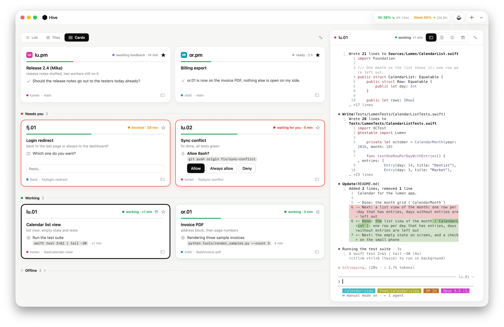
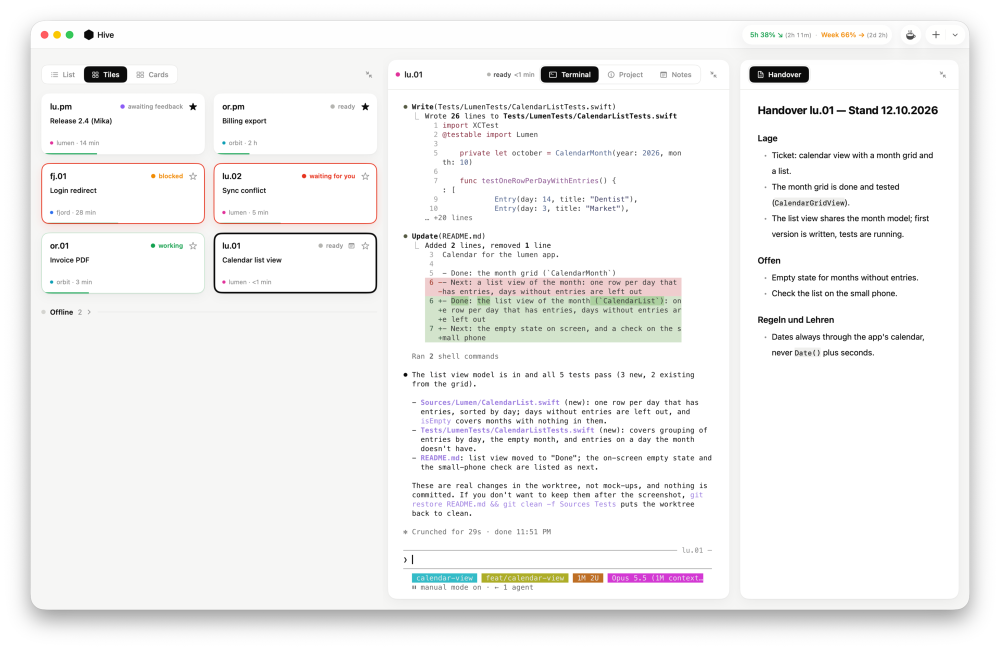
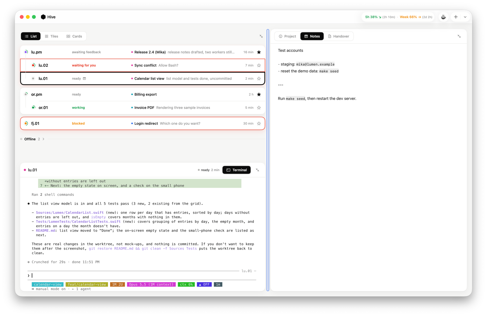
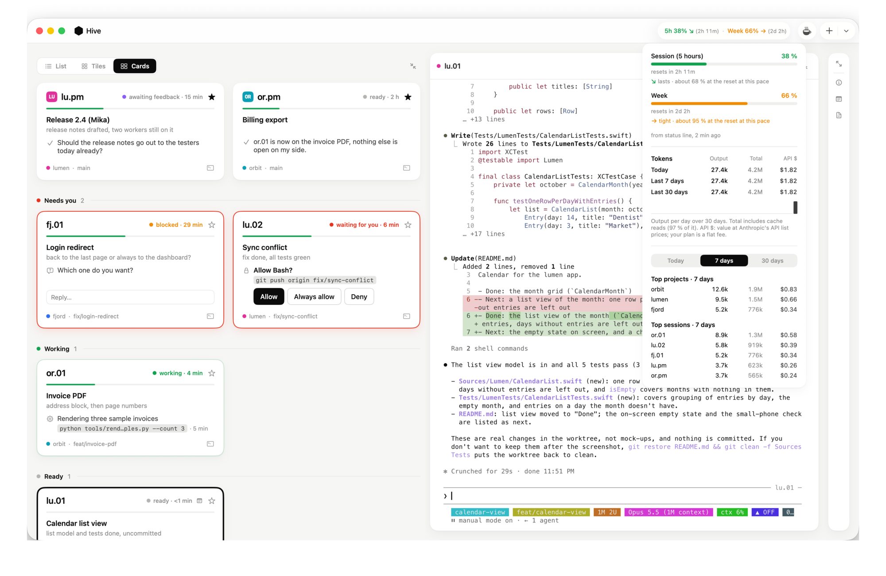
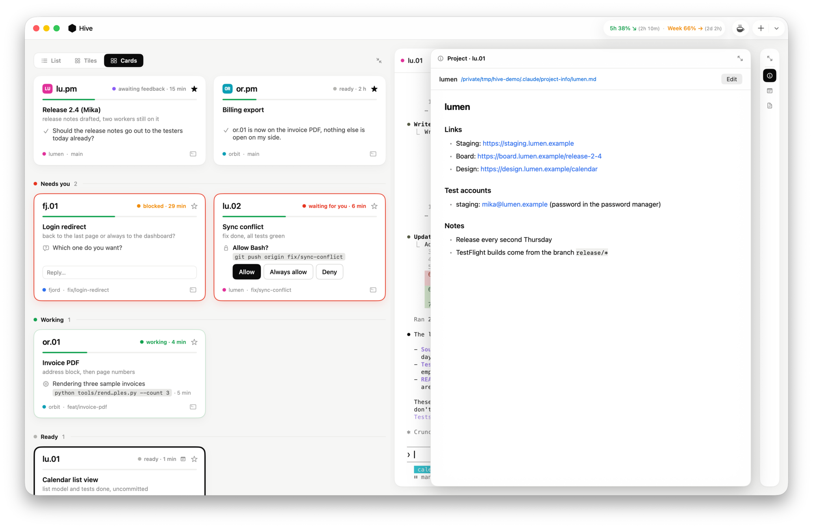
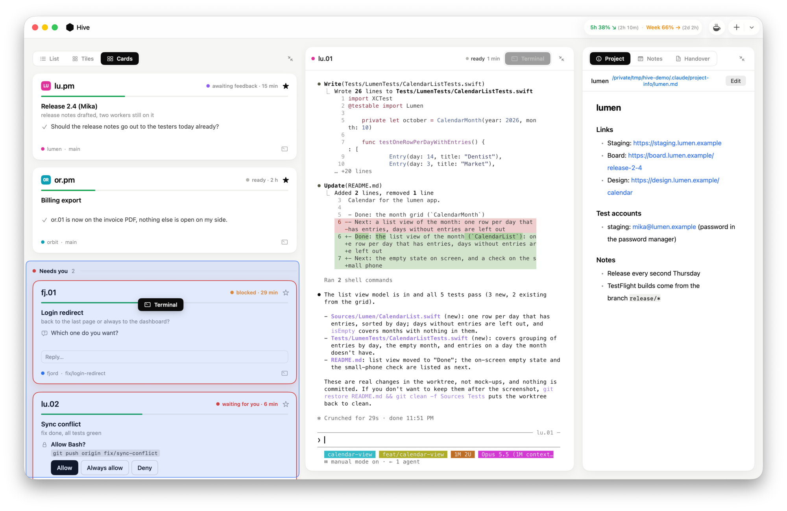

# hive-app

Mac app for parallel Claude Code sessions: the overview of all sessions next to the real terminal of the
selected session (tmux), its handover, its project info and its notes, arranged as tiles. The session tools the app reads from
(`cc-task`, `cc-spawn`, `cc-close`, `cc-handover-load`, `cc-note`) live in `tools/`. Until 2026-10-07 they were a
separate repo `hive` together with a Node/HTML dashboard; its history is merged in here.

What the master session `keeper` changed (including outside the repo): `docs/keeper-log.md`
Current session rules for the global CLAUDE.md: `docs/claude-md-session-status.md`



Names in examples and screenshots are made up (`sh scripts/demo.sh` starts the app with them).

## Features

- Views: List, Tiles, Cards
- Favorites with a star
- ⌘H jumps to the longest-waiting session, cursor into the terminal; press again for the next one
- Notifications and a dock badge count for sessions that need you; optionally a push to the phone via ntfy once the
  Mac has had no input for a while (Settings, ⌘,)
- CPU load per session (its own process and everything it started) as a share of the whole Mac, shown from 5 %,
  orange from 25 %
- Plan limits in the title bar (5 hours and week), colored by the outlook: green lasts until the reset, orange gets
  tight, red runs out before it; a click shows tokens over 1/7/30 days by project and session
- New Session (⌘N) and New Project… (⇧⌘N)
- A notepad per session (Notes, ⌘T): Markdown, stored in `~/.claude/hive/notes/<session>.md`; write it yourself or
  let the session add to it with `cc-note`
- The window is made of tiles: the overview, and Terminal, Handover, Project and Notes of the selected session as
  tabs. Drag a tab (for the overview its view switcher) to place it beside or below another tile
  (drop on its edge), across the whole window (drop at the window's edge) or back onto another tile's tabs (drop in
  the middle); drag the gaps to resize. The arrangement is the same for all sessions; View → Reset Window
  Layout restores the default. The overview always keeps a tile of its own
- A tile can be collapsed to a bar of icons (button at the right of its top row); a click on an icon shows that view
  on top of the rest until you click elsewhere. That layer starts a tenth smaller than the tile beneath; drag its
  free edge to resize it (remembered per tile, double-click resets)
- At launch the first running favorite is selected, else the first working session
- Quick reply and reply buttons in the cards view
- Keeps the Mac awake while sessions work (switch in the title bar and in Settings, ⌘,)
- Sleep When Done: armed once in the title bar, puts the Mac to sleep as soon as no session works any more
  (60 s to cancel; a session that starts working again stops the countdown)
- Settings → Display: a monochrome look (black, white and gray instead of status and project colors; the
  terminal keeps its colors) and switches to hide details: status, time in status, detail line, "Now" line,
  context usage, CPU load, badges, project and branch, and where the session runs
- Own right-click menu: Wake Up / Remote Control / Write Handover, Favorite / Start next, Restart… / Close… / Force Quit…
- Drag & drop into the terminal

## Screenshots

Tiles, with terminal and handover side by side:



List with workers under their PM, the terminal below it and the session's notes on the right:



Plan limits with outlook, and tokens by project and session:



A collapsed tile shows its views as a temporary layer:



Dragging a tab onto another tile:



## Starting

```sh
brew install tmux                  # once
swift run HiveApp
swift run HiveApp --select lu.04   # with a preselected session
sh restart.sh                      # release build, install as /Applications/Hive.app and restart
                                    # (HIVE_INSTALL=~/Applications for another folder)
                                    # (quits only apps started from this folder, including the prototype)
swift test                         # HiveCore tests
```

Test instance alongside the main app (own bundle identifier, doesn't steal its notifications):

```sh
HIVE_APP=HiveApp-dev HIVE_BUNDLE_ID=io.github.tbimyr.hive-app.dev sh restart.sh
```

Test notes folder instead of `~/.claude/hive/notes`: `HIVE_NOTES=<path> swift run HiveApp`.

Demo with made-up sessions (for screenshots), next to the main app and without touching its sessions:

```sh
sh scripts/demo.sh        # own home folder under /tmp (HIVE_HOME), own tmux server (HIVE_TMUX)
sh scripts/demo.sh stop   # quit it and remove the data
```

App icon: `swift scripts/make-icon.swift Resources/AppIcon.iconset && iconutil -c icns Resources/AppIcon.iconset`.

Attaching to a session from outside: `tmux -L hive attach -t '=<name>:'` (colon needed, otherwise tmux reads `.01` as a pane).

## Structure

- `HiveCore`: reads `~/.claude/sessions`, `~/.claude/handover` and the conversation transcripts under
  `~/.claude/projects`. Changes arrive via FSEvents.
- `HiveApp`: SwiftUI window, terminal via SwiftTerm, handover view via MarkdownUI, and its own tmux
  server (`tmux -L hive`).
- `hive-state`: prints the state as JSON.

## Session tools

```sh
sh tools/install.sh                          # symlinks into ~/.claude, hook, CLAUDE.md section
node --test tools/test/*.test.js             # tool tests, no tokens
```

Handover file `~/.claude/handover/<name>.md`, written only by `cc-task`:

```markdown
---
session: lu.01
project: lumen
task: Calendar view          # topic only, at most 4 words / 40 characters
detail: grid done, list view next   # optional subline, at most 120 characters
state: working               # working | blocked | waiting | done | handover
updated: 2026-09-30T16:09:00+02:00
---
# Handover lu.01 — Stand 30.09.2026
## Lage
## Offen
## Regeln und Lehren
```

The name is the key: a new session started with `claude -n lu.01` gets the file as context at
startup (hook `cc-handover-load`), and its task line is set to "neu gestartet" ("restarted").
Previous versions live under `~/.claude/handover/archive/<name>/`. The handover template stays
German on purpose.

```sh
cc-task "Topic" [state]                      # set the task line (body is kept)
cc-task --detail "One line of context" "Topic" working
cc-task --name or.02 "Topic" done            # set another session's line (PM)
cc-task --archive --body file.md "Topic" handover   # write a handover
cc-spawn lu.01 ~/Development/lumen/worktrees/x "Ticket: …"   # new session (hive tmux or iTerm tab)
cc-close lu.01                               # type /exit; refused when busy or without handover
cc-close --force lu.01                       # close anyway
cc-note "Run `make seed`, then restart"      # add to this session's notes (Markdown; long text on stdin)
```

Skills (symlinked into `~/.claude/skills/`): `/status` sets the task line by hand; `/handover`
writes the body to the scratchpad and passes it to `cc-task --archive --body`.

## License

MIT, see [LICENSE](LICENSE).
